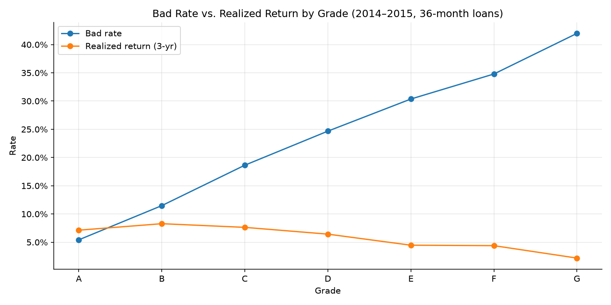
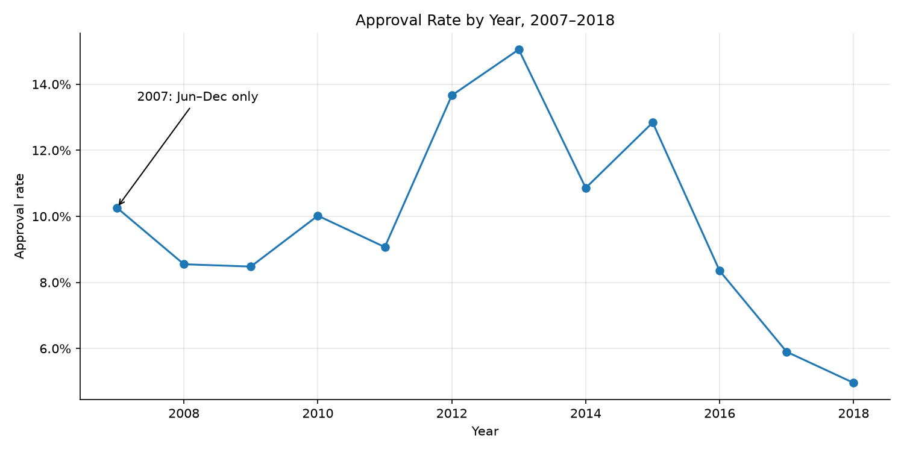
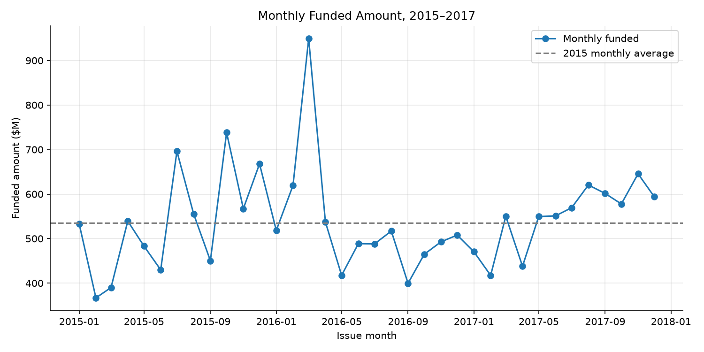
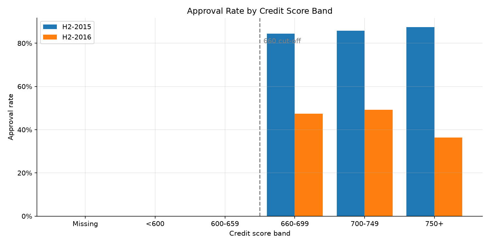
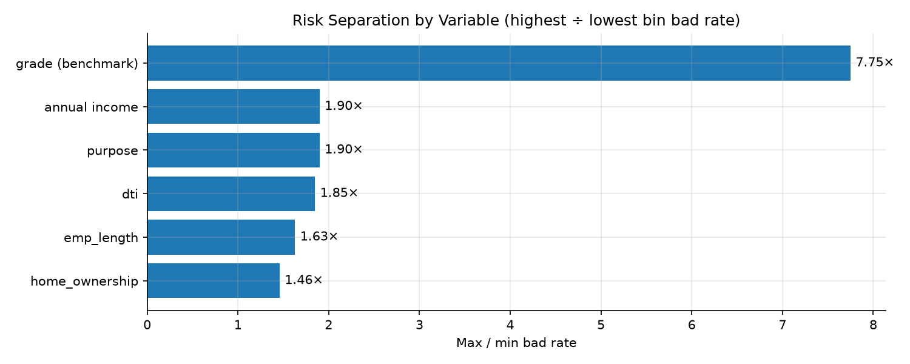

# Consumer Lending Portfolio Analysis: Growth, Risk & Return

**Lending Club, 2007–2018 · 2.26M funded loans · 27.6M declined applications**
SQL (DuckDB) · Python (pandas, matplotlib, Plotly) · Jupyter

### 📊 [Interactive dashboard →](https://qichenz-0825.github.io/lending-club-credit-risk-analysis/)
Hover, toggle and filter every result in the browser.

> An end-to-end credit risk and analytics review of a consumer lending book. I build an analysis-ready loan population and a documented default definition, track growth and the approval funnel, test whether pricing compensates for risk, diagnose a volume anomaly, and identify application-time risk drivers as the groundwork for a PD model.

---

## Executive summary

| # | Question | Answer |
|---|---|---|
| 1 | **How risky is the book?** | On fully matured 2014–2015 36-month loans, **14.5%** went bad. Lending Club's grade **rank-orders risk well**: 5.4% (A) → 42.0% (G), a **7.8×** spread. |
| 2 | **Does pricing cover the extra risk?** | **Losses are covered, but risk isn't paid for.** Every grade is profitable, yet realized 3-year return **peaks at 8.3% in grade B and falls to 2.2% in grade G**. B–C earn **1.8×** the return of E–G at **less than half** the bad rate. |
| 3 | **How is the funnel evolving?** | Funded volume grew from **\$20M (2008) to \$7.9B (2018)**. The approval rate fell from **15.1% (2013) to 5.0% (2018)** because **applications tripled** (2015 → 2018) while approvals rose only 18%. |
| 4 | **What happened in 2016?** | After a one-off spike in **March 2016 (\$949M)**, volume was **down year-over-year for 10 straight months** (Jul-2016 → Apr-2017). The headline **−43% MoM** in April is a **base effect** (YoY: −0.4%). H2-2016 vs. H2-2015: funded **−21.9%**, driven by the **approval rate (−45%)** while **applications rose 54%**. A mix-rate decomposition shows **98% of the approval drop came from lower approval rates within the same credit score bands**, not from weaker applicants. |
| 5 | **Which applicant traits signal risk?** | Income, purpose, DTI, employment length and home ownership all carry signal, but each separates risk by only **1.5–1.9×**, against **7.8×** for grade. Income's **Information Value is 0.06 (weak)** with a monotonic WOE. Missing employment length is a strong flag (21.1% bad rate). A multivariate model is needed. |

### Recommendations
1. **Tighten approval or cap exposure in grades E–G** (4.6% of loans) and redirect volume to **B–C**, the best risk-adjusted segment. Don't simply raise E–G rates: higher prices worsen **adverse selection**.
2. **Monitor volume year-over-year and against a baseline**, not month-over-month: quarter-start peaks and one-off spikes make MoM swings misleading.
3. **Investigate the 2016 approval-rate drop as a supply issue.** Weaker applicants explain only 2% of it; approval rates nearly halved in every score band above the 660 cut-off, and fell most for the best applicants (750+: 87% → 36%), which points to an investor funding constraint rather than credit policy.
4. **Build an application-time PD model** (WOE/IV feature selection → logistic scorecard and gradient boosting) and use grade as the **benchmark** to beat.

---

## Data

| Table | Rows | Description |
|---|---|---|
| `accepted_2007_to_2018Q4.csv` | 2,260,701 | Funded loans: application data, pricing, grade, and performance through Dec-2018 |
| `rejected_2007_to_2018Q4.csv` | 27,648,741 | Declined applications: 9 application-time fields only |

Source: [Kaggle: All Lending Club loan data](https://www.kaggle.com/datasets/wordsmyth/lending-club). See [`Data/README.md`](Data/README.md) to reproduce.

### Methodology

**Performance population.** The data ends in Dec-2018, so only loans that have reached maturity have a known outcome. I use **36-month loans issued in 2014–2015** (445,743 loans): 99.98% have a final status. Newer and 60-month loans are mostly still `Current` (e.g. 27% of 2016 36-month loans and 43% of 2016 60-month loans). Treating them as good would understate the bad rate (right-censoring).

**Target definition** (single source of truth in [`SQL/00_create_views.sql`](SQL/00_create_views.sql)):

| `loan_status` | `bad_flag` |
|---|---|
| Charged Off, Late (31–120 days) | 1 |
| Fully Paid | 0 |
| Current, In Grace Period, Late (16–30 days) | NULL: indeterminate, excluded from rates (86 loans) |

**Metric definitions**

| Metric | Definition |
|---|---|
| Bad rate | Bad loans ÷ loans with a final outcome (`AVG(bad_flag)`) |
| Approval rate | Approved ÷ (approved + rejected applications) |
| Realized return | `SUM(total_pymnt) / SUM(funded_amnt) − 1`: all cash collected (principal, interest, fees, recoveries) vs. all cash lent, 3-year total, before servicing and funding costs |
| Funded volume | `SUM(funded_amnt)`: amount actually lent, not amount requested |
| Information Value | `Σ (dist_good − dist_bad) × ln(dist_good / dist_bad)` across bins: < 0.02 useless, 0.02–0.1 weak, 0.1–0.3 medium, > 0.5 suspect leakage |

**Data quality issues found and fixed**

| Issue | Detection | Fix |
|---|---|---|
| 33 file footer rows (summary text in `id`, all other columns empty) | `loan_status IS NULL` | Dropped |
| `issue_d` stored as text (`'Dec-2015'`): sorts alphabetically | `SELECT DISTINCT issue_d` | `strptime(issue_d, '%b-%Y')` |
| `term = '36 months'` returned 0 rows | Failed sanity check → `LENGTH(term)` = 10 not 9 | Leading space → `TRIM` + cast to integer |
| Income bin boundary `> 100000` dropped **8,430 loans** reporting exactly \$100,000 | Bin counts didn't sum to the population | Inclusive lower bounds + explicit `Missing` bin + coverage `assert` |

---

## Findings

### 1. Grade rank-orders risk, but returns fall as risk rises


| Grade | Loans | Avg rate | Bad rate | Realized return |
|---|---:|---:|---:|---:|
| A | 105,465 | 7.1% | 5.4% | 7.1% |
| **B** | 145,243 | 10.5% | 11.5% | **8.3%** |
| C | 121,499 | 13.5% | 18.6% | 7.6% |
| D | 53,250 | 16.8% | 24.7% | 6.4% |
| E | 16,516 | 19.6% | 30.4% | 4.5% |
| F | 3,343 | 23.9% | 34.8% | 4.4% |
| G | 427 | 26.4% | 42.0% | 2.2% |

*Hypothesis tested:* "lower-grade interest rates don't cover their losses" → **rejected** (all returns positive) and refined to "lower grades aren't **compensated** for their risk". → [notebook 03](Notebooks/03_risk_return_by_grade.ipynb)

### 2. The approval rate fell because applications exploded


| | 2015 | 2018 | Change |
|---|---:|---:|---:|
| Approved loans | 421,095 | 495,242 | +18% |
| Applications | 3,280,474 | 9,992,024 | **+205%** |
| Approval rate | 12.8% | 5.0% | −7.9 pp |

→ [notebook 02](Notebooks/02_portfolio_growth_and_approval.ipynb)

### 3. The 2016 slowdown: a base effect plus a real, year-long decline


* April 2016 fell **−43.4% MoM**, but March (\$949M) was a one-off spike, 77% above the 2015 average of **\$535M/month**.
* From May 2016 to April 2017, monthly volume ran at **\$400–550M**, about **12% below** the 2015 run-rate, and recovered from May 2017.
* **Year-over-year** removes seasonality: April 2016 was only **−0.4% YoY**, but **Jul-2016 → Apr-2017 was negative for 10 consecutive months**, recovering from May 2017.
* YoY is not immune to spikes either: March 2017 shows −42% YoY only because March 2016 was the spike.
* The timing coincides with Lending Club's May 2016 governance crisis (CEO resignation, investor pullback).

**Decomposition, H2-2016 vs. H2-2015** (funded = applications × approval rate × avg loan size):

| Driver | H2-2015 | H2-2016 | Change |
|---|---:|---:|---:|
| Applications | 1,871,026 | 2,879,775 | **+53.9%** |
| Approval rate | 12.9% | 7.0% | **−45.4%** |
| Avg loan size | \$15,250 | \$14,161 | −7.1% |
| **Funded** | \$3,675M | \$2,870M | **−21.9%** |

Demand rose; the decline came from approvals.

**Did applicants get worse? Mix vs. rate by credit score band** (approved: FICO; declined: `Risk_Score`)



| | H2-2015 | H2-2016 |
|---|---:|---:|
| Approval rate | 12.88% | 7.04% |
| Share of applicants scoring 660+ | 15.2% | 15.0% |
| Approval rate within 660–699 / 700–749 / 750+ | 84% / 86% / 87% | 47% / 49% / 36% |

* Below 660 nobody is approved (a **knockout rule**). ~80% of declined applications have **no score**: they fail eligibility checks before a credit pull.
* Decomposition of the **−5.84 pp** drop: **mix effect −0.12 pp (2%)**, **rate effect −5.73 pp (98%)**. The applicant-quality hypothesis is rejected.
* The steepest drop is among the **best** applicants, unusual for a credit-policy change, which points toward the investor funding constraint after May 2016.

→ [notebook 04](Notebooks/04_volume_anomaly_2016.ipynb)

### 4. Application-time risk drivers


| Variable | Lowest-risk bucket | Highest-risk bucket | Spread |
|---|---|---|---:|
| Grade *(benchmark)* | A: 5.4% | G: 42.0% | 7.8× |
| Annual income | \$100k+: 10.3% | <\$40k: 19.6% | 1.9× |
| Purpose | Credit card: 12.0% | Small business: 22.8% | 1.9× |
| DTI | 0–10: 11.2% | 30–40: 20.6% | 1.8× |
| Employment length | 10+ years: 12.9% | Missing: 21.1% | 1.6× |
| Home ownership | Mortgage: 11.8% | Rent: 17.2% | 1.5× |

* Income and DTI are **monotonic**, which is required for scorecard bins.
* **DTI** contains impossible values (max 999 vs. 99th percentile 37.8), likely placeholders; binning absorbs them.
* **Missing employment length** is the strongest single flag (21.1% vs. 14–15%): missing not at random, so it gets its own bin rather than being imputed.
* Tiny categories (`wedding` 11 loans, `educational` 1, home ownership `ANY` 2) show 0% bad rates only by chance and must be merged.
* The max/min ratio ignores bin sizes (purpose ranks high because of `small_business`, 0.9% of loans). **Information Value** weights every bin: income scores **IV = 0.06 (weak)**, with WOE rising monotonically from −0.37 (< \$40k) to +0.38 (≥ \$100k).
* Counter-intuitive: mortgage holders default **less** than outright owners (11.8% vs. 15.4%). A plausible explanation is prior bank underwriting; this still needs testing.
* **Feature rule:** only information available **at the decision point**. `total_pymnt`, `recoveries`, `last_pymnt_d` and `last_fico_range_*` are post-origination and would leak the outcome.

→ [notebook 05](Notebooks/05_application_risk_drivers.ipynb)

---

## Limitations
* Single-variable views: correlated drivers (e.g. income and home ownership) will not add up linearly.
* Returns are 3-year totals before servicing fees and funding costs, not annualized IRR.
* Grade G (427 loans) and home ownership `ANY` (2 loans) are too small for firm conclusions.
* `grade` and `int_rate` are outputs of Lending Club's own model. They serve as a benchmark, not as model inputs.
* Year-level approval rates are approximate: rejections are dated by application, approvals by issue date.

## Roadmap
- [x] Data preparation, target definition, data quality fixes
- [x] Portfolio growth and approval funnel
- [x] Risk vs. return by grade
- [x] Volume anomaly diagnosis
- [x] Year-over-year view and driver decomposition of the 2016 slowdown
- [x] Univariate application-time risk drivers (income, DTI, employment length, purpose, home ownership)
- [x] Interactive results dashboard (GitHub Pages)
- [x] Mix vs. rate decomposition of the 2016 approval-rate drop
- [x] WOE / Information Value method (income)
- [ ] Information Value for all application-time variables
- [ ] PD model: logistic scorecard and XGBoost; KS, AUC, Gini, calibration, PSI
- [ ] Cut-off strategy: approval rate vs. bad rate trade-off, expected loss (PD × LGD × EAD)

## Daily work log
The day-by-day working notebooks, cleaned up, show how the analysis was built: exploration, dead ends, the bugs found and how they were fixed.

| Day | Notebook | Focus |
|---|---|---|
| 1 | [day1_exploration_and_cleaning](Notebooks/worklog/day1_exploration_and_cleaning.ipynb) | Profiling, data quality fixes, target definition, bad rate by grade, approval rate (CTE + JOIN) |
| 2 | [day2_joins_and_returns](Notebooks/worklog/day2_joins_and_returns.ipynb) | INNER vs. LEFT JOIN experiment, realized return by grade, data leakage |
| 3 | [day3_trends_and_risk_drivers](Notebooks/worklog/day3_trends_and_risk_drivers.ipynb) | Grade segments, monthly trend + `LAG` window function, home ownership, income binning |
| 4 | [day4_yoy_decomposition_and_drivers](Notebooks/worklog/day4_yoy_decomposition_and_drivers.ipynb) | YoY with `LAG(x, 12)`, volume decomposition, pandas profiling and binning (DTI, employment length, purpose) |
| 5 | [day5_mix_rate_and_iv](Notebooks/worklog/day5_mix_rate_and_iv.ipynb) | `UNION ALL`, `PARTITION BY`, mix vs. rate decomposition, Simpson's paradox, WOE / IV |

---

## Repository structure
```
├── README.md                    ← this report
├── SQL/
│   └── 00_create_views.sql      ← cleaning, cohort, target definition, applications (single source of truth)
├── src/
│   ├── lending_db.py            ← CSV → Parquet conversion + DuckDB connection with views
│   ├── build_dashboard.py       ← exports results to the interactive dashboard
│   └── dashboard_template.html
├── docs/index.html              ← interactive dashboard (GitHub Pages)
├── Notebooks/
│   ├── 01_data_preparation.ipynb
│   ├── 02_portfolio_growth_and_approval.ipynb
│   ├── 03_risk_return_by_grade.ipynb
│   ├── 04_volume_anomaly_2016.ipynb
│   ├── 05_application_risk_drivers.ipynb
│   └── worklog/                 ← cleaned day-by-day working notebooks
├── images/                      ← charts used in this README
└── Data/                        ← raw data (not tracked; see Data/README.md)
```

## How to reproduce
```bash
pip install -r requirements.txt
# download the two CSVs into Data/ (see Data/README.md), then run the notebooks in order
jupyter lab Notebooks/
```
The first run converts the CSVs to Parquet (a few minutes). Each notebook then runs in seconds.
Rebuild the dashboard with `python src/build_dashboard.py`.
